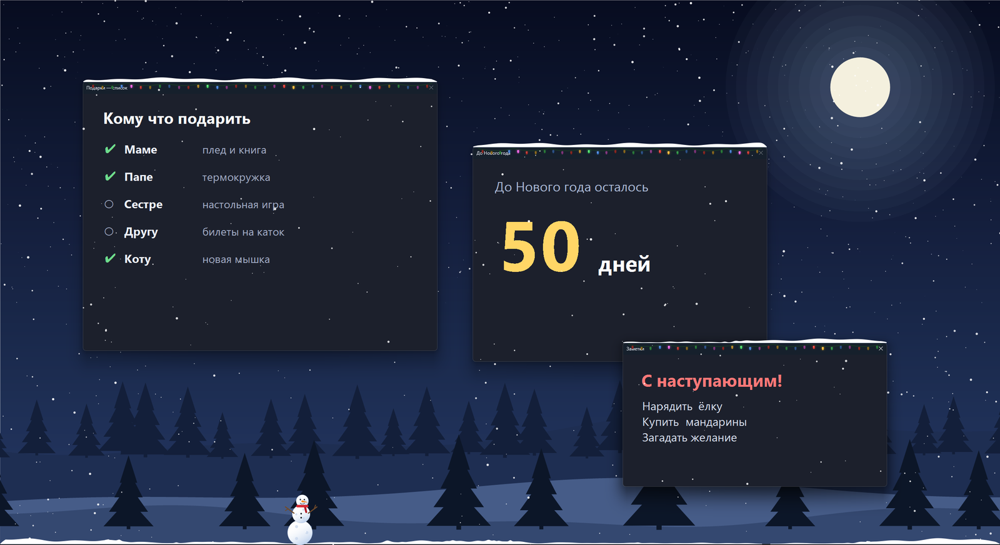

# HNY — Happy New Year

Новогоднее настроение на рабочем столе Windows: снег поверх всех окон, сугробы, гирлянды, снежки и снегоуборщик.



## Что умеет

### Снег и сугробы

Снег падает поверх всего рабочего стола и не мешает работать — клики проходят насквозь. На верхних кромках окон и на панели задач постепенно наметает сугробы.


### Гирлянда

Под заголовком каждого окна висит гирлянда с мигающими лампочками. Режимы мигания сменяются сами: цвета по очереди, бегущая волна, вразнобой.

### Снег осыпается

Если окно сдвинуть, свернуть или закрыть, снег с него осыпается и ложится на то окно или панель задач, что окажется ниже.


### Снежки и снеговик

Зажмите левую кнопку мыши на сугробе — получится снежок. Катайте его по сугробу, чтобы он вырос, и отпустите. Поставьте три снежка друг на друга — и получится снеговик.

<p align="center"></p>

### Снегоуборщик

Когда панель задач засыпает, на неё выезжает снегоуборщик и счищает снег. Если на пути попадётся снежок, он его отбросит.

<p align="center">
  
  
</p>

### Музыка

Пока идёт снегопад, приглушённо играет новогодняя песня. Когда снег на паузе или открыто полноэкранное окно (видео, игра), музыка плавно затихает. Включить, выключить и настроить громкость можно в меню трея: «Музыка».

### И ещё

- Работает на нескольких мониторах, у каждой панели задач свой снегоуборщик.
- На мониторе с полноэкранным окном (игра, видео) снег не рисуется.

Всё управление — через иконку-снежинку в трее: пауза, сила снегопада, музыка и её громкость, отключение отдельных эффектов, вызов снегоуборщика, выход. Настройки запоминаются между запусками.

## Требования

- Windows 10/11 x64
- Для сборки: [.NET SDK 10](https://dotnet.microsoft.com/download)
- Для установщика: [WiX Toolset v3](https://wixtoolset.org/)
- Или установить готовый msi

## Запуск из исходников

```
dotnet run -c Release
```

## Сборка установщика

```
powershell -ExecutionPolicy Bypass -File installer\build.ps1
```

Скрипт публикует самодостаточный `HNY.exe` (устанавливать .NET на целевой компьютер не нужно) и собирает `dist\HNY-Setup.msi`.

## Структура

| Файл               | Что внутри                                        |
| ------------------ | ------------------------------------------------- |
| `src/Program.cs`   | Точка входа, прозрачное окно-оверлей, меню в трее |
| `src/Engine.cs`    | Цикл отрисовки, снежинки, сугробы, поиск окон     |
| `src/Garland.cs`   | Гирлянда                                          |
| `src/Snowballs.cs` | Снежки и снеговик                                 |
| `src/Plow.cs`      | Снегоуборщик                                      |
| `src/Native.cs`    | Объявления Win32 API                              |
| `installer/`       | Сценарий WiX, генератор иконки, скрипт сборки     |
